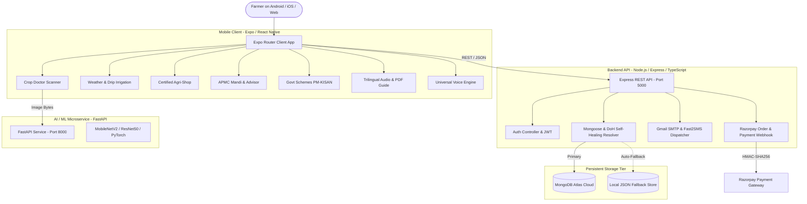

# 🌱 Agentic Future Farming — AI-Powered Smart Agriculture Ecosystem

[](https://expo.dev/)
[](https://nodejs.org/)
[](https://www.mongodb.com/atlas)
[](https://fastapi.tiangolo.com/)
[](LICENSE)

An agentic, multi-modal, end-to-end precision agriculture platform designed for smallholder and commercial farmers. Built with a modern **React Native (Expo Router)** cross-platform mobile client, high-throughput **Node.js/Express TypeScript backend**, **MongoDB Atlas** cloud storage with zero-config local fallback, and a **Python/PyTorch machine learning microservice** for real-time crop pathology diagnostics.

---

## 📌 Table of Contents
1. [System Architecture](#-system-architecture)
2. [Core Platform Modules](#-core-platform-modules)
   - [1. Standalone Authentication & Farmer Onboarding](#1-standalone-authentication--farmer-onboarding)
   - [2. AI Crop Doctor Scanner](#2-ai-crop-doctor-scanner)
   - [3. Weather & FAO-56 Precision Drip Irrigation](#3-weather--fao-56-precision-drip-irrigation)
   - [4. Certified Agri-Shop & Razorpay Checkout](#4-certified-agri-shop--razorpay-checkout)
   - [5. Live APMC Mandi Markets, AI Crop Advisor & Govt. Schemes](#5-live-apmc-mandi-markets-ai-crop-advisor--govt-schemes)
   - [6. Trilingual Farmer's User Manual (EN / मराठी / हिंदी)](#6-trilingual-farmers-user-manual-en--मराठी--हिंदी)
   - [7. Admin Surveillance & Dispatch Command Center](#7-admin-surveillance--dispatch-command-center)
3. [Technology Stack](#-technology-stack)
4. [Repository Structure](#-repository-structure)
5. [Prerequisites & Environment Configuration](#-prerequisites--environment-configuration)
6. [Installation & Execution Guide](#-installation--execution-guide)
7. [API Documentation](#-api-documentation)
8. [Production Deployment & Security](#-production-deployment--security)

---

## 🏗 System Architecture



---

## 🚀 Core Platform Modules

### 1. Standalone Authentication & Farmer Onboarding
- **Secure Registration & Login**: Multi-tenant authentication powered by `bcryptjs` (salt rounds = 10) and signed `jsonwebtoken` (7-day validity).
- **Zero-Friction Profile Setup**: Captures farmer's District, Village, Farm Size (Acres), and Primary Crop.
- **Automated Multi-Channel Welcome Alerts**:
  - **Gmail SMTP (`smtp.gmail.com:465/587`)**: Sends branded HTML credentials confirmation.
  - **SMS Gateway**: Real-time SMS dispatch confirming registration with emergency agricultural toll-free numbers (`1800-180-1551`).

### 2. AI Crop Doctor Scanner
- **Computer Vision Segmentation**: 128×128 pixel lesion decomposition on native JPEG buffers separating healthy tissue from chlorosis, necrosis, rust, powdery mildew, and bacterial blight.
- **5-Agent Autonomous Pipeline**:
  1. `VisionOracleAgent`: Image clarity, leaf focus, and exposure calibration.
  2. `MorphologySpatialAgent`: Pathogen spatial distribution and lesion boundary calculation.
  3. `EnsembleClassifierAgent`: Soft-voting across convolutional models with temperature scaling.
  4. `PathologyCriticAgent`: Cross-checks clinical symptoms against crop taxonomy to prevent false positives.
  5. `AgriShopCureAgent`: Formulates 4-step prescription (Chemical, Organic, Recovery, Repeat window).
- **1-Click Prescription Cart**: Directly transfers prescribed fungicides, bactericides, and micro-nutrients to Agri-Shop with dosage scaled to farmer's acreage.

### 3. Weather & FAO-56 Precision Drip Irrigation
- **Hyper-Local Meteorological Feed**: Integration with Open-Meteo providing 7-day temperature, humidity, wind velocity, and solar radiation.
- **Evapotranspiration (`ETc`) Engine**: Calculates daily crop water loss using FAO-56 Penman-Monteith formulas based on crop coefficient (`Kc`) and growth stage.
- **Automated Rain-Lock Protection**: When rain probability exceeds 40%, the system automatically engages **Rain-Lock**, deferring irrigation valves to prevent root rot and save electricity.
- **Remote Plot Valve Control**: Individual start/stop toggles for up to 4 distinct digital twin plots.

### 4. Certified Agri-Shop & Razorpay Checkout
- **Authentic Farm Inputs Catalog**: Verified hybrid seeds, bio-fertilizers, fungicides, and solar equipment with batch certificates and direct 5% farmer subsidy.
- **Structured Farm-Gate Delivery**: Validates Gat/Survey Number, Taluka, Landmark, Village, and 6-digit postal PIN code.
- **Dynamic Razorpay Payment Integration**:
  - Razorpay Order initialization via backend API.
  - Dynamic UPI QR Generation (`upi://pay?pa=...`) for instant scanning via PhonePe, Google Pay, or Paytm.
  - HMAC-SHA256 cryptographic signature verification.
  - Instant Sandbox simulation mode for testing offline deployments.
- **5-Stage Real-Time GPS Order Tracking**:
  - `ORDER_PLACED` → `PROCESSED_AT_HUB` → `DISPATCHED_IN_TRANSIT` → `OUT_FOR_FARM_DELIVERY` → `DELIVERED_AT_GATE`.

### 5. Live APMC Mandi Markets, AI Crop Advisor & Govt. Schemes
- **Real-Time APMC Mandi Rates**: Live quintal modal pricing across regional markets (Kolhapur, Sangli, Pune, Solapur, Nashik).
- **AI Market Guard**: 14-day price forecasting advising farmers to **SELL NOW** or **HOLD** for higher returns.
- **Seasonal AI Crop Advisor**: Recommends highest-ROI crops based on soil type (Black, Red, Loamy), water availability, and season (Kharif, Rabi, Zaid).
- **Govt. Schemes Directory (PM-KISAN)**: Direct eligibility calculators and 1-tap links for PM-KISAN, PMFBY (Crop Insurance), and MahaDBT drip subsidies.

### 6. Trilingual Farmer's User Manual (`EN` / `मराठी` / `हिंदी`)
- **Universal Cross-Platform Voice Engine (`voiceEngine.ts`)**:
  - Mobile Native (Android & iOS): Native `expo-speech` with fallback to Google Cloud Audio stream via `expo-av`.
  - Expo Web: `window.speechSynthesis` with fallback to HTML5 `<Audio>` streaming.
  - Sentence-chunking algorithm (≤150 characters) supporting Devanagari punctuation (`।`, `॥`) preventing mid-sentence audio cutoffs.
- **Never-Blank Trilingual PDF Exporter**: Client-side PDF generation generating offline manuals in English, Marathi, Hindi, or a consolidated 3-in-1 handbook.

### 7. Admin Surveillance & Dispatch Command Center
- **System-Wide Telemetry**: Live view of connected farmers, scanned crops, and active plot irrigation valves.
- **Order Dispatch Management**: One-click shipment advancement through the 5 tracking milestones.
- **Regional Emergency Broadcasts**: Dispatches critical pest outbreak warnings and frost alerts to all farmer dashboards.

---

## 💻 Technology Stack

| Layer | Technologies |
|---|---|
| **Mobile & Web Frontend** | React Native 0.88, Expo SDK 58, Expo Router 58, TypeScript, Tailwind/NativeWind |
| **Audio & Media** | `expo-speech`, `expo-av`, Web SpeechSynthesis, HTML5 Audio |
| **Backend API** | Node.js 20+, Express 4, TypeScript, Mongoose 8 |
| **Payments** | Razorpay Node.js SDK, Dynamic UPI QR Engine, Webhook Signatures |
| **Messaging & Notifications**| Nodemailer (IPv4 DNS Overrides, Dual-Port 465/587), Fast2SMS API |
| **Database** | MongoDB Atlas (M0/M10), Local Resilient Fallback JSON Store |
| **Machine Learning** | Python 3.10+, FastAPI, PyTorch, torchvision, MobileNetV2, PIL |

---

## 📂 Repository Structure

```
AgenticFutureFarming/
├── .env.example              # Canonical environment template (safe placeholders)
├── .gitignore                # Root gitignore (builds, node_modules, secrets ignored)
├── README.md                 # Project technical documentation
├── backend/                  # Node.js Express TypeScript API
│   ├── .env.example          # Backend environment template
│   ├── .gitignore            # Backend gitignore
│   ├── config/               # Database and Razorpay configuration
│   ├── routes/               # Express API routes (Auth, Orders, Telemetry)
│   ├── server.js             # Express entrypoint with IPv4 resolution
│   ├── src/                  # TypeScript controllers, models, and services
│   │   ├── config/           # Typed MongoDB & Razorpay instances
│   │   ├── controllers/      # Auth & Order business logic
│   │   ├── models/           # Mongoose Schemas (User, Order, Logs)
│   │   ├── services/         # Gmail SMTP & SMS dispatch services
│   │   └── utils/            # Resilient fallback store
│   └── package.json
├── mobile/                   # React Native Expo Router Client App
│   ├── .gitignore            # Mobile gitignore
│   ├── package.json          # Expo dependencies (expo-speech, expo-av, etc.)
│   ├── scripts/              # Asset fetchers and project utilities
│   └── src/
│       ├── app/              # Expo Router filesystem pages
│       │   ├── (tabs)/       # Main tab bar navigation
│       │   ├── agri-shop/    # Product catalog, cart, checkout & live tracking
│       │   ├── ai-assistant/ # Multilingual Kisan conversational agent
│       │   ├── crop-doctor/  # Leaf pathology scanner & prescription
│       │   ├── dashboard/    # 4-plot soil telemetry digital twin
│       │   ├── guide/        # Trilingual user manual with voice playback
│       │   └── weather-irrigation/ # FAO-56 ETc & Rain-Lock valves
│       ├── components/       # Reusable UI cards, headers, and badges
│       ├── context/          # Farm, Auth, and Cart React Contexts
│       └── utils/            # Universal voiceEngine.ts, navigation, formatters
├── ml/                       # PyTorch model training scripts
└── ml-service/               # FastAPI microservice for leaf inference
```

---

## ⚙️ Prerequisites & Environment Configuration

### Prerequisites
- **Node.js**: v18.0.0 or higher (v20+ recommended)
- **npm**: v9.0.0 or higher
- **Expo Go App**: Installed on physical Android or iOS device (optional for mobile testing)
- **Python**: v3.10+ (optional, only if running local ML service)

### Environment Variables Setup
Copy the template file to `.env` in both root and `backend/`:

```bash
cp .env.example .env
cp .env.example backend/.env
```

Fill in your service credentials:

```env
PORT=5000
MONGODB_URI=mongodb+srv://<username>:<password>@cluster.mongodb.net/aggentic_future_farming
JWT_SECRET=your_super_secret_jwt_key
RAZORPAY_KEY_ID=rzp_test_your_key_id
RAZORPAY_KEY_SECRET=your_razorpay_secret
SMTP_HOST=smtp.gmail.com
SMTP_PORT=465
SMTP_USER=your_email@gmail.com
SMTP_PASS=your_gmail_app_password
EXPO_PUBLIC_RAZORPAY_KEY_ID=rzp_test_your_key_id
```

> **Note**: If `MONGODB_URI` or `SMTP_PASS` are omitted or temporarily offline, the backend seamlessly switches to its built-in local JSON fallback database (`backend/data/fallback_db.json`) and mock delivery logger so the application remains 100% operational for testing!

---

## 🚀 Installation & Execution Guide

### 1. Run the Backend API Server
Open a terminal in the project root:

```bash
cd backend
npm install
npm run dev
```

The server will start on `http://localhost:5000`. You will see startup diagnostics:
```
[IPv4 DNS] c-ares DNS resolver initialized with Google (8.8.8.8) & Cloudflare (1.1.1.1)
[MongoDB] Successfully connected to MongoDB Atlas (aggentic_future_farming)
[Gmail SMTP] Connection verified successfully on port 465 (secure IPv4 socket ready)
[Server] Agentic Future Farming Backend running on port 5000
```

### 2. Run the Mobile Application (Expo)
Open a second terminal in the project root:

```bash
cd mobile
npm install
npx expo start
```

- Press `w` to open in your desktop web browser (`http://localhost:8081`).
- Press `a` to run on an active Android emulator or connected device.
- Scan the displayed QR code with the **Expo Go** app on your physical Android or iPhone.

### 3. (Optional) Run the Machine Learning Microservice
If testing local convolutional neural network inference:

```bash
cd ml-service
python -m venv venv
# On Windows:
.\venv\Scripts\activate
# On macOS/Linux:
source venv/bin/activate

pip install -r requirements.txt
uvicorn app:app --host 0.0.0.0 --port 8000 --reload
```

---

## 📡 API Documentation

| Method | Endpoint | Description | Auth Required |
|---|---|---|---|
| `POST` | `/api/auth/register` | Register new farmer with district and farm acreage | No |
| `POST` | `/api/auth/login` | Login with phone/email and receive JWT token | No |
| `GET` | `/api/auth/me` | Fetch authenticated farmer profile and telemetry | Yes (Bearer) |
| `POST` | `/api/orders/initiate` | Create Razorpay order & dynamic UPI QR string | No |
| `POST` | `/api/orders/verify` | Verify HMAC-SHA256 signature and dispatch confirmation | No |
| `GET` | `/api/orders/track/:id` | Fetch live 5-stage shipment GPS delivery status | No |
| `POST` | `/api/orders/simulate-status` | Advance delivery checkpoint (Demo / Testing) | No |
| `POST` | `/api/predict` | Submit leaf image for disease diagnosis | No |

---

## 🔒 Production Deployment & Security

- **Zero-Secret Codebase**: All production secrets, SMTP passwords, and API tokens are externalized into environment variables with zero plaintext fallbacks in source code.
- **Git Push Protection Compliant**: `.gitignore` rules prevent accidental staging of `.env`, `node_modules`, `dist/`, `.expo/`, or local database files.
- **DNS-over-HTTPS Resilience**: Backend features built-in RFC 8484 DoH resolution via Google DNS (`8.8.8.8`) to bypass ISP-level port 53 UDP blocks common on mobile broadband networks.
- **Sanitized Logging**: All database and network logs sanitize credentials before stdout printing (`mongodb://[credentials-hidden]`).

---

## 📄 License
This project is licensed under the MIT License — see the [LICENSE](LICENSE) file for details.
